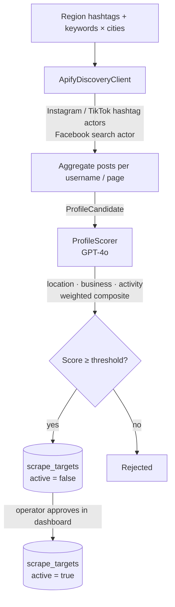
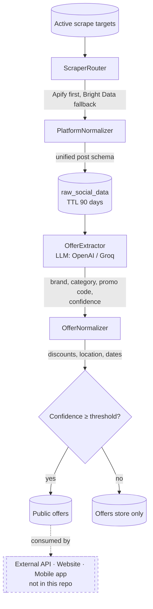
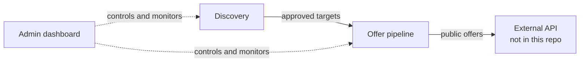

# Social Offer Intelligence — Aggregation Pipeline


https://github.com/user-attachments/assets/50e69d57-dac0-44c1-b983-a76bd9b288db


An LLM-powered data pipeline that discovers commercial social-media accounts,
scrapes their posts, and turns unstructured promotional text into clean,
normalized, publishable offers — operated through a real-time admin dashboard.

> **Scope note:** This repository contains only the **aggregation layer** of a
> larger production system built for a client: account discovery, scraping,
> LLM extraction, normalization, and the internal operations dashboard. The
> **external API** that serves the collected offers and the **website and
> mobile application** that present them to end users are not included, due to
> client policy. What's here is complete, independently runnable, and
> representative of the system's engineering as a whole.
>
> No real client data is included. Region names, hashtags and account handles
> in the configuration are illustrative.

---

## Overview

Brands and shops announce promotions (discounts, promo codes, flash sales)
almost exclusively on Instagram, TikTok and Facebook — in free text, often in
Arabic, French or English dialects. Turning that noise into structured data
doesn't scale by hand. This project automates the full loop:

1. **Discovery** — finds *new* business accounts per geographic region from
   hashtag and keyword × city searches, then scores each candidate with an
   LLM. Candidates wait in a human review queue.
2. **Scraping & Extraction** — scrapes approved profiles on a schedule, then
   uses an LLM to extract brand, category, offer type, promo code and a
   confidence score from each post.
3. **Normalization & Publication** — normalizes discounts, locations and
   validity dates, and promotes offers above a confidence threshold to a
   public collection with a configurable lifetime.

Both the discovery engine and the scrape → extract → publish pipeline run
standalone, from the CLI or from the dashboard, and are designed to run
unattended on a schedule.

## Key Capabilities

- **Multi-platform scraping** — Instagram, TikTok and Facebook through Apify,
  with automatic fallback to Bright Data when the primary provider fails
- **Geo-based account discovery** — hashtag scraping (Instagram, TikTok) and
  keyword × city page search (Facebook), aggregated per account before scoring
- **LLM-as-classifier scoring** — each candidate gets location, business and
  activity scores (0–100), combined into a weighted composite and gated by a
  minimum threshold
- **Human-in-the-loop approval** — discovered profiles are stored inactive and
  can only be scraped after an operator approves them in the dashboard
- **Provider-switchable LLM extraction** — OpenAI or Groq, models and
  generation parameters controlled from config, with a cheaper model for the
  normalization pass
- **Offer normalization** — discount type and amount, currency, country/city
  and validity dates mapped to a consistent schema
- **Confidence-gated publication** — only offers above a configurable
  confidence threshold reach the public collection, with a configurable
  lifetime
- **Idempotent storage** — raw posts upserted on `post_id`, targets keyed on
  `(platform, target_type, value)`, already-extracted offers skipped on re-run
- **Operations dashboard** — KPIs, AI-quality metrics, alerts, live logs, run
  history, target management, and an in-browser JSON config editor
- **Multi-region** — preset regions from config or ad-hoc manual regions with
  custom hashtags, all driven from the UI

## Architecture

### Discovery layer



### Offer pipeline



### End-to-end handoff



## Components

| Component | Layer | Type | Purpose |
|---|---|---|---|
| **ApifyDiscoveryClient** | Discovery | Tools | Runs Apify hashtag / search actors and aggregates results into one candidate per account |
| **ProfileScorer** | Discovery | LLM | Scores each candidate on location, business nature and activity and returns structured JSON; a weighted composite and a threshold decide acceptance |
| **DiscoveryStorage** | Discovery | Deterministic | Idempotent upserts into `scrape_targets`; never overwrites operator-added profiles; 7-day re-discovery window |
| **DiscoveryEngine** | Discovery | Orchestrator | Runs scrape → score → store per region and platform, with per-platform stats |
| **ScraperRouter** | Pipeline | Tools | Tries Apify, falls back to Bright Data, returns results plus the source used |
| **PlatformNormalizer** | Pipeline | Deterministic | Maps each provider's different payload shape to one normalized post schema |
| **RawSocialDataStore** | Pipeline | Deterministic | Upserts raw posts on `post_id`; TTL index purges data after 90 days |
| **OfferExtractor** | Pipeline | LLM | Extracts structured offer data from post text and persists it with a confidence score |
| **OfferNormalizer** | Pipeline | LLM + deterministic | Normalizes discounts, location and validity dates |
| **PipelineManager** | Dashboard | Orchestrator | Thread-safe singleton owning run / stop / schedule lifecycle, log capture, run history and config file I/O |
| **DashboardService** | Dashboard | Deterministic | All Mongo aggregations behind the dashboard, with a mock-data fallback |

## Technical Workflow

A production cycle looks like this:

1. An operator (or the discovery scheduler, default every 48 hours) runs
   **discovery** for a region, with the hashtags and platforms chosen in the
   dashboard.
2. Candidates are scored and stored as *pending*. The operator approves or
   rejects them, singly or in bulk.
3. The **pipeline** is triggered once or on a schedule
   (`global_scrape_interval_hours`, with per-platform overrides). For each
   platform it scrapes all active profiles in a single provider call.
4. Each post is stored raw, extracted, normalized and — if it clears the
   confidence threshold — published. Posts already processed are skipped.
5. Run history is persisted in MongoDB; logs stream to the dashboard through
   incremental polling.

## Technology Stack

- **Backend:** Python 3.12, FastAPI, Uvicorn, Pydantic v2, Jinja2
- **Database:** MongoDB via PyMongo — `social_scraper` for raw data and
  targets, `offer_insights` for offers
- **Scraping:** Apify (primary) and Bright Data (fallback), `asyncio` and
  `aiohttp`
- **LLMs:** OpenAI (`gpt-4o`, `gpt-4o-mini`) and Groq
  (`llama-3.3-70b-versatile`), switchable through config
- **Scheduling:** in-process timer / thread schedulers for the dashboard,
  `schedule` for the CLI runner
- **Dashboard frontend:** single-page app in vanilla JS with Chart.js and D3

## Project Structure

```
.
├── README.md
├── requirements.txt
├── runtime.txt
├── .gitignore
├── main.py                       # FastAPI entry point, router wiring, page routes
├── ScrapeTargetStore.py          # targets store used by the dashboard
├── test.py                       # one-off Mongo migration script
│
├── api/                          # dashboard backend
│   ├── __init__.py               # assembles dashboard / targets / discovery / pipeline routers
│   ├── db.py                     # DashboardService: Mongo aggregations + mock fallback
│   ├── pipeline_manager.py       # run lifecycle, log buffer, history, config I/O
│   ├── static/
│   └── routers/
│       ├── __init__.py
│       ├── overview.py           # /api/dashboard/stats/overview
│       ├── scraping.py           # /api/dashboard/stats/scraping
│       ├── offers.py             # /api/dashboard/stats/offers
│       ├── config.py             # /api/dashboard/stats/config
│       ├── system.py             # /api/dashboard/health, database-stats, max-profiles
│       ├── targets.py            # /api/targets
│       ├── discovery.py          # /api/discovery/*
│       ├── pipeline.py           # /api/pipeline/*
│       └── main.py
│
├── discovery/                    # geo-based profile discovery
│   ├── __init__.py
│   ├── config.py                 # regions, actors, thresholds, scoring weights
│   ├── apify_client.py           # Instagram / TikTok hashtag + Facebook search scraping
│   ├── scorer.py                 # LLM scoring of candidates
│   ├── engine.py                 # orchestrator: scrape → score → store
│   ├── storage.py                # idempotent upserts into scrape_targets
│   └── requirements
│
├── offer_intel/                  # scrape → extract → normalize → publish
│   ├── __init__.py
│   ├── pipeline.py               # per-post processing + PipelineScheduler
│   ├── cli.py                    # run / run --once / normalise
│   ├── config/
│   │   ├── scraper_config.json
│   │   ├── schedule_config.json
│   │   ├── llm_config.json
│   │   └── platform_config.json
│   ├── scraping/
│   │   └── scrapers.py           # ApifyScraper, BrightDataScraper, ScraperRouter
│   ├── storage/
│   │   ├── raw_social_data_store.py
│   │   └── scrape_target_store.py
│   ├── extraction/
│   │   └── offer_extractor.py    # LLM offer extraction
│   ├── normalization/
│   │   ├── platform_normalizer.py
│   │   └── offer_normalizer.py
│   └── utils/
│       └── settings.py           # env + JSON config loading
│
├── config/
│   └── schedule_config.json
├── profiles/
│   └── targets.py
├── templates/
│   └── dashboard.html            # admin dashboard (single page)
└── static/
```

## Installation

```bash
git clone <this-repo>
cd <this-repo>
python -m venv .venv && source .venv/bin/activate   # Windows: .venv\Scripts\activate
pip install -r requirements.txt
```

You also need a running MongoDB instance (local or Atlas).

## Configuration

Two layers of configuration, deliberately kept separate:

- **`.env`** — secrets and connection strings only. Never committed.
- **`offer_intel/config/*.json`** — everything else: scraper providers and
  actor IDs, intervals, LLM models and parameters. Contains no credentials
  and is editable from the dashboard.

```env
MONGO_URI=mongodb://localhost:27017
MONGO_DB_NAME=offer_insights
OPENAI_API_KEY=...
GROQ_API_KEY=...
APIFY_API_TOKEN=...
BRIGHTDATA_API_TOKEN=...            # optional, enables the fallback provider
PUBLIC_CONFIDENCE_THRESHOLD=0.7     # minimum confidence to publish an offer
PUBLIC_LIFETIME_DAYS=60             # lifetime of a published offer
```

| Config file | Controls |
|---|---|
| `scraper_config.json` | Providers, Apify actor IDs / Bright Data dataset IDs, URL templates, result limits |
| `schedule_config.json` | Global scrape interval and per-platform overrides |
| `llm_config.json` | Default provider, models, temperature / top_p / max tokens for extractor and normalizer |
| `platform_config.json` | Platform payload normalization schemas |

Discovery regions, hashtags, thresholds (`MIN_SCORE_TO_STORE`) and scoring
weights live in `discovery/config.py`.

## Running the Dashboard

```bash
# local development
python main.py
# → http://127.0.0.1:8000/dashboard     (API docs at /docs)

# hosted / remote server (listen on all interfaces)
uvicorn main:app --host 0.0.0.0 --port 8000
# → http://<your-server-ip-or-domain>:8000/dashboard
```

Seven tabs: Overview, Scraping Analytics, Offer Intelligence, Target
Management, Configuration, Target Discovery and Pipeline.

## Running the Pipeline

```bash
# scrape all platforms once, then exit
python -m offer_intel.cli run --once

# continuous mode, driven by schedule_config.json
python -m offer_intel.cli run

# normalize pending extracted offers
python -m offer_intel.cli normalise --platform instagram --limit 100
```

The same runs can be started, stopped and scheduled from the **Pipeline** tab,
and discovery from the **Target Discovery** tab.

## Example Workflow

A single account's path through the system, illustratively:

1. Discovery scrapes posts under a regional hashtag. One account appears
   several times; its captions and hashtags are aggregated into a single
   candidate.
2. The scorer reads the captions and raw payload, finds a city name in a
   caption, sees prices and discounts in several posts, and returns high
   location, business and activity scores. The composite clears the threshold,
   so the profile is stored as *pending*.
3. An operator reviews it in the dashboard and approves it. It becomes an
   active scrape target.
4. At the next pipeline run it is scraped. Each post is stored raw; the LLM
   extracts brand, category, offer type and promo code with a confidence score.
5. The normalizer structures the discount and validity dates. Offers above the
   confidence threshold are published; the dashboard's charts and alerts update
   accordingly.

## Engineering Decisions

- **LLM proposes, code disposes.** The scorer's LLM returns a `recommended`
  flag, but acceptance is also gated in code: the weighted composite must
  reach a minimum score. A prompt instruction is a strong signal, not a
  guarantee, so no single LLM response decides on its own.
- **Human-in-the-loop for new targets.** Discovered profiles are written with
  `active: false` and can't be scraped until approved. This keeps scraping
  cost and data quality under operator control.
- **Idempotency everywhere.** Upserts on natural keys and an extraction
  existence check make every stage safe to re-run, so a crashed or repeated
  run never duplicates data.
- **Never overwrite operator data.** Discovery only refreshes
  `discovery_meta` on profiles that already exist, and re-discovery is
  rate-limited by a 7-day window.
- **Provider fallback instead of provider lock-in.** The router isolates
  scraping vendors behind one interface, so an outage at one provider
  degrades to the other instead of stopping collection.
- **Behaviour in config, not code.** Actors, intervals, models and generation
  parameters are JSON files editable from the UI, with live JSON validation;
  changes apply on the next run.
- **Lazy imports for resilience.** The dashboard imports the pipeline package
  only when a run starts, so the UI stays up even if the pipeline package is
  missing or broken.

## Reliability / Error Handling

- Each stage catches and logs per-item failures (a single profile or post)
  instead of aborting the run; the run record stores success, error and
  counters.
- The scrape router falls back from Apify to Bright Data and returns an empty
  result with a logged error if both fail.
- Bright Data polling is bounded (fixed retry count) and raises a timeout
  rather than waiting forever.
- Invalid or non-JSON LLM responses in discovery scoring are caught and the
  candidate is rejected with a recorded reason.
- The dashboard falls back to mock data when MongoDB is unreachable, and every
  stats endpoint returns a safe empty structure on error.
- Raw data expires automatically through a 90-day TTL index.
- The pipeline manager guards shared state with a lock, supports a stop signal
  between platforms, and can cancel a schedule without interrupting a run in
  progress.

## Security

- All credentials are read from environment variables; the JSON configs
  contain no secrets.
- `.env` is git-ignored.
- This repository intentionally excludes real client data and the external
  API, website and mobile application.
- **Not production-hardened:** the dashboard has no authentication and CORS is
  open for development — see Limitations.

## Limitations

Documented honestly, as this is a real system and not a polished demo:

- No automated test suite ships in this repository.
- The dashboard and its API have **no authentication**, and CORS allows all
  origins. It is meant to run on a trusted network or behind a gateway.
- Schedulers are in-process threads and timers. State such as "next run" lives
  in memory, a restart cancels active schedules, and the design assumes a
  single process.
- Discovery scoring is sequential (one LLM call per candidate, with a short
  delay for rate limits), so large candidate sets are slow.
- Facebook discovery is deliberately capped (a limited number of keywords and
  cities per run) to control actor cost.
- Scoring weights and the acceptance threshold were set by hand rather than
  derived from a labeled evaluation set.
- LLM output is parsed with `json.loads`; a malformed response rejects the
  candidate instead of being repaired.
- The dashboard's run loop partly mirrors the pipeline module's own scrape
  function rather than reusing it directly, which creates some duplication.

## Future Improvements

Kept separate from what is actually implemented above:

- Add authentication and role-based access to the dashboard and API.
- Move scheduling to a distributed queue (Celery / Arq) so state survives
  restarts and the system can scale horizontally.
- Use structured outputs / function calling for LLM calls to remove manual
  JSON parsing.
- Add an automated test suite with mocked provider and LLM responses, plus an
  evaluation set for tuning scoring weights and thresholds.
- Containerize the stack (Docker Compose with MongoDB) and add CI.
- Add structured logging and run metrics beyond the in-dashboard log stream.

## Author

**MAD** — AI / NLP / LLM Engineer

*(This project was built for a real client; the aggregation layer shown here
is shared publicly with the client's scope boundary respected — see the scope
note at the top of this README.)*
